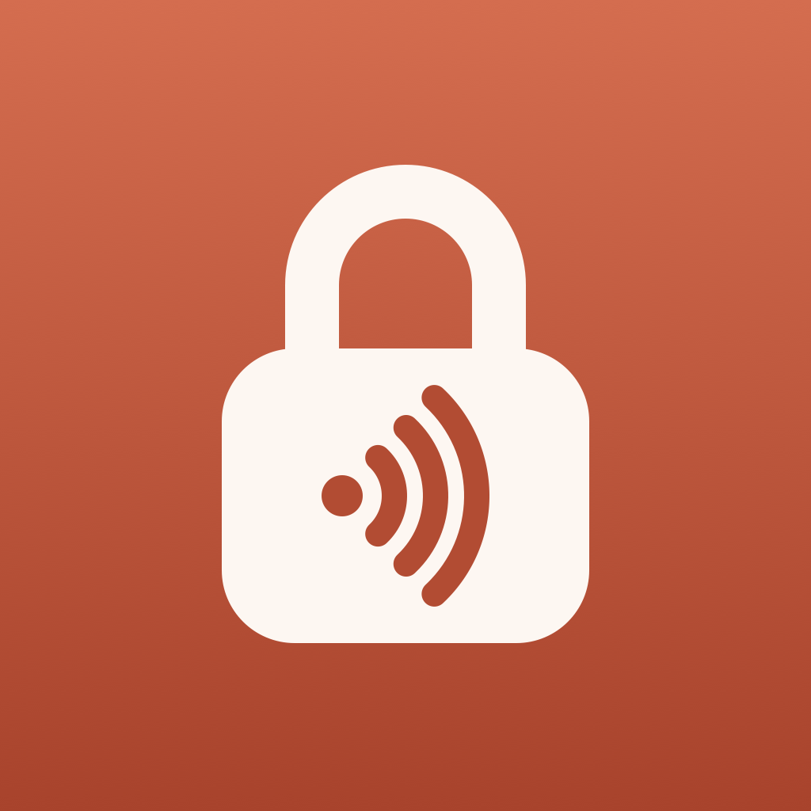

# LockIt

LockIt is an iPhone app that blocks distracting apps and websites until you tap a physical NFC card. You choose what to block, tap your card to lock it, and tap the same card to unlock. No other card works.

It is a personal build: there is no App Store version. You install it on your own iPhone from Xcode, and this page shows how.



## What it does

- **Card-gated blocking.** Lock and unlock with one paired NFC card. Any other tag is rejected.
- **Modes.** Named sets of apps, categories and websites. A mode can block what you pick, or block everything except what you pick.
- **Schedules.** Lock at the same time every day without opening the app. A schedule can unlock by itself at the end, or stay locked until you tap your card.
- **Emergency Unlocks.** Five ways out for when you can't reach your card. The count never resets, and it survives deleting the app.
- **Strict Mode.** While locked, no app on the phone can be deleted, and Emergency Unlock is hidden.
- **Stats.** Time locked today and this week, your longest streak, and a session history.

Everything stays on the phone. There is no account, backend or analytics.

## What you need

| | |
|---|---|
| **Mac** | Xcode 16 or later. The project was built with Xcode 27.2. |
| **iPhone** | iOS 17 or later, connected by cable for the first install. |
| **Apple Developer Program** | A paid membership. A free Personal Team cannot sign apps that read NFC tags. |
| **NFC card** | An NTAG215 card or sticker. Any MIFARE Ultralight family tag works. Bank cards, transit cards and MIFARE Classic do not. |

The iOS Simulator cannot run this app usefully. Screen Time and NFC only work on a real iPhone.

## Install it with Xcode

### 1. Get the code

```bash
git clone https://github.com/starepravojr/LockIt.git
```

```bash
open LockIt/LockIt.xcodeproj
```

### 2. Point the project at your own developer team

The project is set up for its author's team, and app identifiers can belong to only one team. Unless you are the author, change them to your own before building.

1. Install XcodeGen, which builds the Xcode project from `project.yml`:

   ```bash
   brew install xcodegen
   ```

2. In `project.yml`, set `DEVELOPMENT_TEAM` to your 10-character Team ID. You can find it under Membership details at [developer.apple.com/account](https://developer.apple.com/account).
3. In `project.yml` and in `LockIt/App/AppConfig.swift`, replace every `com.starepravo` with a prefix of your own, such as `com.yourname`. There are seven in `project.yml` and three in `AppConfig.swift`. The two files have to agree, because the App Group ID appears in both.
4. Regenerate the project from the repository folder, then reopen it in Xcode:

   ```bash
   xcodegen generate
   ```

If you are the author, skip this step.

### 3. Prepare your iPhone

1. Connect the iPhone to the Mac and tap **Trust** on the phone.
2. Turn on Developer Mode: **Settings > Privacy & Security > Developer Mode**. The phone restarts. The option appears once the phone has been connected to Xcode.

### 4. Build and run

1. In Xcode's toolbar, choose the **LockIt** scheme and your iPhone as the destination.
2. Press **Run** (⌘R).

The first build takes a little longer. Xcode registers three app identifiers and an App Group on your team, and creates the provisioning profiles. If it reports a signing error, select each of the three targets in turn (LockIt, LockItMonitor, LockItShield), open **Signing & Capabilities**, and check that your team is selected.

### 5. Set up the app

On first launch LockIt walks you through three steps:

1. **Allow Screen Time access.** Choose Continue, then confirm with Face ID or your passcode.
2. **Pair your card.** Hold the top back edge of the iPhone against the card.
3. **Create your first mode.** Pick the apps, categories and websites to block.

Then tap **Lock It** and tap your card.

## Keeping it installed

An app installed from Xcode stops opening when its provisioning profile expires, which is one year after the first build. To renew it, connect the phone and press Run again. Your modes, schedules, paired card and Emergency Unlock count are kept.

Renew before the expiry date. If the profile expires while your apps are locked, LockIt will not open, so you cannot tap your card. If that happens, run it from Xcode again, or turn off LockIt under **Settings > Screen Time** to release the block.

## Troubleshooting

**"Provisioning profile ... doesn't include the Family Controls (Development) capability"**
This appears when you archive and distribute the app, for example to TestFlight. The project uses the development version of Family Controls, which only works for builds run from Xcode. Distribution needs a separate entitlement that the team's Account Holder requests from Apple at [developer.apple.com/contact/request/family-controls-distribution](https://developer.apple.com/contact/request/family-controls-distribution), once for each of the three app identifiers. To use the app on your own phone, press Run instead of archiving.

**The card is not detected**
Hold the card against the top back edge of the iPhone and keep it still. A thick or metal case can block the read. If the card is stuck to something metal, leave a gap of a few millimetres or use a ferrite sticker.

**"Unsupported card"**
The tag is not in the MIFARE Ultralight family. Use an NTAG213, NTAG215 or NTAG216.

**Screen Time access was declined**
Open LockIt and tap **Try again**. The note above the button says what stopped it, for example a missing passcode or a parental restriction.

**You lost your card while locked**
Use an Emergency Unlock in the app's Settings. If Strict Mode is on, that option is hidden, and the only way out is to turn off LockIt under **Settings > Screen Time**. LockIt treats that as a bypass and takes one Emergency Unlock.

## Limits worth knowing

- A card tap only works from inside the app. iOS does not let a background tap run the app's code.
- A card's ID can be copied onto a special "magic" tag. This is a self-discipline tool, not a security product.
- Only the iPhone is blocked. iPads and Macs are not.
- Schedules repeat every day and must last at least 15 minutes, which is an iOS limit.

## Project layout

```
project.yml       Source of truth for the Xcode project (XcodeGen)
LockIt/           The app
  App/            App entry point, shared identifiers, app state
  Models/         Modes, schedules, lock state, session log
  Services/       Screen Time shields, NFC, Keychain, schedules, stats
  Views/          SwiftUI screens
LockItMonitor/    Extension that starts and ends scheduled sessions
LockItShield/     Extension that draws the screen over a blocked app
Tools/            Script that draws the app icon
```

`LockIt.xcodeproj` is generated. Change project settings in `project.yml` and run `xcodegen generate`, because edits made in Xcode's project editor are overwritten the next time it is generated.
